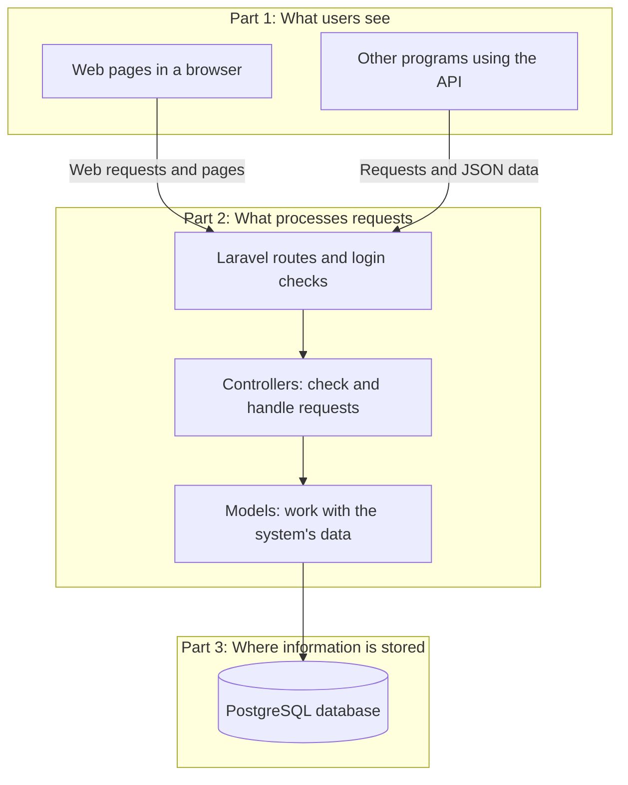

# GuidanceSched: presentation outline

Use this outline to explain the system in 11 slides. It is based on the project files. Any proposed improvements are labeled as recommendations. No load-test results are available yet.

## 1. Title

**GuidanceSched**  
A school guidance appointment and case-record system  
How it works, how it is set up, and how it protects information

Presenter: [Name] · School: [School] · Date: [Date]

## 2. Organization and problem

- **Organization:** a school guidance center that arranges student consultations and follow-up.
- **Problem:** appointment requests, student details, private case records, and follow-up notes can be hard to keep organized when tracked separately.
- **What the system does:** helps staff manage appointments, accounts, case records, and follow-ups. It also provides different pages for different users and a few ways for other programs to exchange data with it.
- **Project limit:** this is a school project prototype. It has not had a formal school privacy review and is not ready to be described as a production counseling system.

## 3. Users and main tasks

| User | What they can do |
| --- | --- |
| Admin / guidance staff | Manage accounts; schedule, approve, complete, or cancel appointments; view and update case records; add follow-up notes |
| Teacher | Work with assigned students; create consultation requests and set available times; view related appointments |
| Student | View their own assigned consultation date, time, and status; staff create requests for them |

Main tasks:

1. A staff member creates an appointment request for a student.
2. A teacher sets a time, or an admin schedules and approves it.
3. Staff records a case and can add follow-up notes later.
4. An admin manages user accounts.

## 4. Three main parts of the system

- **Part 1 — What users see:** web pages in a browser. Other programs can also use the system through its API, a few web addresses for exchanging information.
- **Part 2 — What processes requests:** the Laravel app checks who is signed in, checks what they are allowed to do, and handles their request.
- **Part 3 — Where information is stored:** the PostgreSQL database saves users, appointments, case records, and follow-ups.
- These are three parts of how the system works. They are not three separate apps: the current setup runs one Laravel app and one database.

## 5. How a teacher schedules an appointment

Example: a teacher sends an appointment request with a chosen time.

1. The teacher submits a form on a web page or sends a request through the API.
2. The Laravel app receives the request.
3. It checks that the teacher is signed in and allowed to work with that student.
4. It checks that the student and time are valid and that the time is available.
5. The app saves the appointment as **pending**, with the student, teacher, and time. The default appointment length is 30 minutes.
6. The database saves the appointment. The system then shows an updated page or sends back a result to the API user.
7. An admin can later approve, complete, or cancel the appointment.

The system can reject a request if the user is not signed in (API: 401), is not allowed to do it (403), or entered invalid information (422).

## 6. How parts of the system communicate

| Connection | What happens |
| --- | --- |
| Browser to app | The browser sends a web request and receives a page. Users sign in to the website. Use HTTPS, the secure form of web traffic, when people connect over a network. |
| Other program to app | A program can use the API to send or receive information as JSON, a simple text format computers use to share data. It signs in with an existing account. Use HTTPS when sending login details over a network. |
| App to database | The app sends database requests over the private Docker network. Database login details come from settings outside the source code. |

- The API shows lists in smaller pages of results. It returns JSON data and uses error codes when something goes wrong.
- Students see only limited information about their own appointments. Only admins can use the case and follow-up API addresses.
- The API uses Basic Authentication, a simple sign-in method. Before real use, the school should review whether a stronger sign-in method is needed.

## 7. Where the system runs

**Current setup for development and demos:** Docker Compose starts the app and database.

- **App container:** runs the GuidanceSched website using PHP 8.5.
- **Database container:** runs PostgreSQL 18 and stores the system's information.
- Docker connects the two containers on a private network. The database port is only opened to the local computer in the checked-in setup.
- The app's project files are shared with its container so developers can work on them.

**Recommendation before shared use:** put the app behind a secure HTTPS connection, keep the database private, protect passwords and other secret settings, and set up monitored backups. The project does not include a complete setup for a live production service.

## 8. What information is stored

| Record | Examples of stored information |
| --- | --- |
| Users | Name, email, password saved in protected form, role, student and guardian contact details, assigned teacher |
| Appointments | Student, staff member, title, reason, date and time, length, status, staff-only notes |
| Cases | Student, staff member, case number, title, description, category, status, session details, findings and recommendations |
| Follow-ups | Case, staff member, date, notes, action taken |
| Web sessions | Information that keeps a user signed in while using the website |

- The database connects related records, such as a case to a student or an appointment to its creator.
- Case descriptions, findings, recommendations, and follow-up notes should be restricted to authorized staff. The appointment API leaves out staff-only notes.
- Database backups should be kept somewhere protected. Test restoring a backup only in a separate test database.
- The school should decide how long records are kept and when they are deleted. The project does not set these rules.

## 9. Security and student privacy (RA 10173)

- RA 10173, the Data Privacy Act of 2012, says personal information must be handled with transparency, for a proper purpose, and only as much as needed. See the [National Privacy Commission's copy of the law](https://privacy.gov.ph/data-privacy-act/).
- **Already in the project:** users must sign in; the app checks user roles and access; only admins can view case and follow-up records; forms check the information entered; passwords are saved in protected form; students see limited appointment details; anyone cannot sign themselves up.
- **Private information in the system:** student and guardian details, appointment reasons, case descriptions, findings, recommendations, and follow-up notes.
- **Before using real student information:** the school should explain why it collects information, who can see it, how it is protected, and when it is deleted. Use secure connections, protect backups, review staff access, and plan what to do if information is exposed.
- These system features do not prove that the school follows the law. Ask the school's Data Protection Officer to review the system before using real student records. Use made-up records for demos.

## 10. Checking speed and comparing designs

**Speed test status:** the project has no recorded test results. Run the test with made-up data before presenting any speed numbers.

When testing, record:

- Date, PHP and database versions, and computer or server used.
- Which page or API address was tested, how many requests were sent, and how many at once.
- How many requests succeeded or failed, how long they took, and how many requests finished per second.
- Repeat the test and note whether the app had already been used recently.

Suggested small test: request the appointment list 100 times, with 5 requests at once, using the made-up admin account. This is only a basic check, not proof the system can handle a large school. Do not test with real student information or on a shared live system without approval.

| Design | Possible benefit | Possible cost |
| --- | --- | --- |
| Current design: one Laravel app and one database | Easier to set up and maintain for a small project; related changes can be saved together | If more capacity is needed, the app is scaled as a whole; all features share one release |
| Split the system into several apps | Each app could be changed or scaled separately | More pieces to set up, connect, secure, and monitor; keeping information in sync is harder |

To compare the designs, test the same tasks on the same computer or server. Compare speed, errors, computer use, ease of maintenance, and whether information stays consistent. No such comparison has been run yet; the table lists expected trade-offs only.

## 11. Limits and next steps

**Current limits**

- This is a prototype and has not had a formal school privacy review.
- No speed test or design comparison results have been recorded.
- The API sign-in and local Docker setup need review before shared or real use.
- The school has not set record-keeping time limits or a full plan for monitoring and responding to problems.
- The local setup does not include a complete plan for keeping a live service available or recovering from a major failure.

**Next steps**

1. Ask school staff and the Data Protection Officer to review the work process, information collected, who can see it, and when it should be deleted.
2. Review sign-in, secure connections, passwords and secret settings, activity records, and how access is checked.
3. Write down how to back up and restore information and respond to a security problem.
4. Run and record speed tests using made-up records.
5. Try the system with made-up records first. Use real student information only after school approval.

---

**Project files used:** `README.md`, `compose.yaml`, web and API routes, appointment controllers, and database setup files. Laravel Boost setup could not finish because Composer could not connect to Packagist; this outline was prepared by reading the project files directly.
